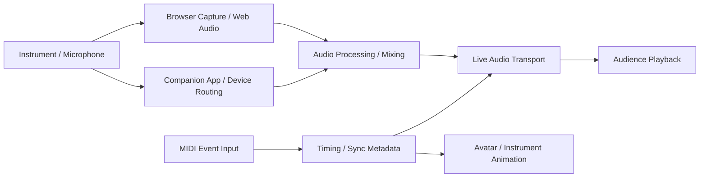

# Live Audio Architecture (`INVESTIGATE` / Highest-Risk Area)

> **Status:** `INVESTIGATE` — Do NOT commit to a media server, WebRTC SFU/vendor, codec, or numeric latency target before Phase 1 PoC (Experiments A, B, C, F).

## Critical Distinctions
1. **Audio Waveform Stream vs MIDI/Event Stream:**
   - **Audio stream** carries actual audible sound (capture → encode → transport → jitter buffer → decode → playback).
   - **MIDI/event stream** carries note-on/note-off/velocity/CC for instrument animation & visual feedback—not a substitute for audio unless a synth is intentionally used.
2. **Performer Monitoring Latency vs Audience Delivery Latency vs Animation Sync:**
   - Measure all three independently in Phase 1 PoC.

## Conceptual Pipeline (`PROPOSED`)

## Phase 1 PoC Acceptance Questions (`TBD-10`)
1. Reliable browser capture across target desktop browsers?
2. Measured end-to-end audience latency under realistic networks?
3. Audio quality degradation under jitter & packet loss?
4. Multi-performer mixing/delivery (Solo, Duo, Band, Orchestra)?
5. MIDI event timestamping & animation sync accuracy?
6. Seamless live ↔ prerecorded switching (`LMR-06`)?
7. Audio device disconnect recovery?
8. Exact Companion App scope where browser fails (`TBD-09`, `TBD-24`)?
9. OS/browser/device compatibility matrix?
10. Performer monitoring path?

Related: [[System-Architecture]] | [[Development-Roadmap]] | [[Decision-Backlog]]
