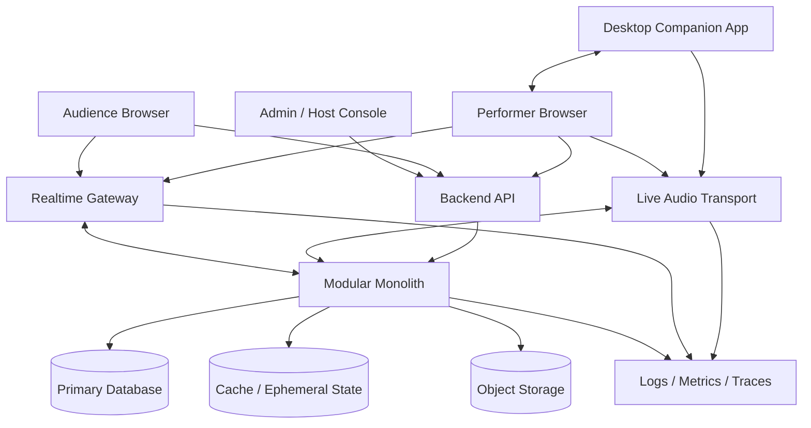

# System Architecture (`PROPOSED` Baseline)

> **Status:** `PROPOSED` (Confirmed directions are explicitly marked; stack choices require PoC validation and ADR approval).

## Confirmed Technical Directions (`CONFIRMED`)
- Browser-first web application (`TA-01`).
- React + TypeScript + Three.js / React Three Fiber (`TA-03`).
- Modular Monolith backend initially (`TA-06`).
- Grouped multiplayer state synchronization (`TA-04`).
- Browser Audio + optional Desktop Companion App (`TA-02`, `TA-05`).
- Launch target: 100–500 global CCU; Small Room 10–20 capacity (`TA-07`, `AR-02`).

## Logical System Context (`PROPOSED`)

## Proposed Backend Module Boundaries
- Identity | Authorization | User Profile | Room | Auditorium | Seating
- Event | Concert | Performance | Performer | Instrument
- Moderation | Copyright | Analytics | Admin

## Frontend State Separation (`PROPOSED`)
Keep separated:
1. Domain/application state
2. UI state
3. Realtime state
4. Local 3D simulation/render state (never push per-frame transforms through React global store)
5. Audio engine state

Related: [[Audio-Architecture]] | [[Multiplayer-Architecture]] | [[Data-Model]] | [[ADR-000-Template]]
